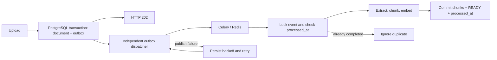

# Document ingestion and semantic search

## Scope

PDF, TXT, and Markdown uploads are limited to 10 MiB and PDFs to 100 pages. OCR is excluded. Deterministic token chunking defaults to 800 tokens with 120-token overlap. The OpenAI provider defaults to text-embedding-3-small with 1536 dimensions. Semantic search uses pgvector cosine distance and requires workspace and knowledge-base filters.

## Transactional upload and delivery

Upload writes the file to shared document storage and inserts both the PENDING document and its document_outbox event in one PostgreSQL transaction. HTTP 202 means the document and processing intent are durably recorded, including when Redis is unavailable. No Celery publish is performed by the request. If the database transaction fails, neither row is committed. A crash before the database commit can leave an unreferenced file, but not a committed document without its intent.



The independent `python -m app.services.outbox` process polls PostgreSQL. Compose starts it as the `outbox` service with restart enabled; it does not need a Celery beat task or a healthy broker to run. Dispatchers claim due rows with FOR UPDATE SKIP LOCKED and retain the lock through publication and commit. Broker failures retain the event with a safe last_error and exponential delay from 2 seconds up to 300 seconds; retries have no fixed exhaustion limit. Connection/socket timeouts bound a failed broker attempt. `--once` attempts one due event for diagnostics.

`published_at` is set only after publishing succeeds. A crash before publish or before committing that timestamp releases the row lock and leaves an event eligible for retry. The same event ID is included in every delivery and used as the Celery task ID. The task ID alone does not deduplicate Celery delivery.

## Idempotent consumption

Delivery is at least once. Ingestion locks the outbox row, checks processed_at, and keeps that lock through extraction and embedding. It commits the replacement chunks, READY status, and processed_at together. Concurrent/repeated deliveries of a completed event return without embedding again. If processing or its commit fails, the completion marker and chunks roll back together. A failed attempt may incur another provider call; the database effects remain idempotent.

Outbox-driven PROCESSING is part of that transaction, so status readers see PENDING (or the previous FAILED) until READY/FAILED is committed. Celery acknowledges ingestion after execution and rejects on worker loss, allowing redelivery. Redis uses a named volume and AOF with appendfsync always. Worker-loss recovery can wait for the Redis visibility timeout. Do not remove the Redis volume while work is outstanding.

Processing failures commit a safe FAILED message and use the existing three Celery retries. FAILED can be visible during backoff and does not necessarily mean retries are exhausted. The outbox retries publication, not permanently invalid files. Legacy direct processing calls remain compatible; only deliveries carrying an outbox ID receive event deduplication.

## Migration and operations

Migration 0003_document_outbox adds the outbox, a unique document constraint, retry fields, completion timestamps, and a partial index for due events. It backfills existing PENDING uploads and resets/requeues only FAILED documents whose failure_reason is exactly `document could not be queued for processing`. Other FAILED, READY, and PROCESSING documents are not replayed.

For an existing deployment, stop accepting uploads and drain old workers before rollout. Build the new API/worker/outbox images, start PostgreSQL/Redis, run `docker compose run --rm --no-deps api alembic upgrade head`, then start API, worker, outbox, and web. This avoids old workers processing tasks without event IDs concurrently with new deliveries. Migrated pending files must still exist at their recorded shared-storage paths. Redis now requires a persistent named volume; migrate/drain any outstanding old ephemeral queue before recreating Redis.

Monitor `docker compose logs --tail=100 outbox` and the oldest due event, attempts, and last_error in document_outbox. No raw broker error is persisted. If a dispatcher restarts or PostgreSQL recovers, polling resumes; if every dispatcher is stopped, intents remain durable but publication waits. Retain processed events while duplicate messages can still be redelivered.

Downgrading 0003 removes outbox delivery/deduplication history but preserves documents and chunks. Stop the outbox and drain outstanding work before downgrading. Downgrading 0002 removes ingestion tables and the status enum, retaining the shared vector extension. It destroys ingestion data.

## Search

POST `/api/v1/workspaces/{workspace_id}/knowledge-bases/{knowledge_base_id}/search`

```json
{"query": "Qual é o prazo para reembolso?", "top_k": 5}
```

The response includes document_id, content, score, and duration_ms. Authentication and answer-generating chat remain outside this implementation.
