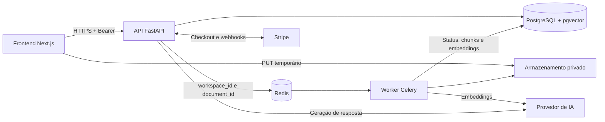
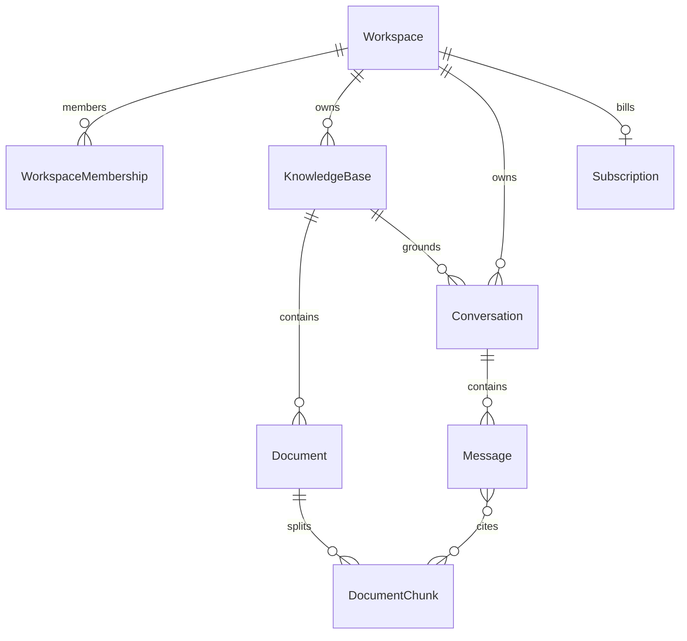

# ADR 0001 — Arquitetura e contratos iniciais

**Status:** proposto para revisão no PR.  
**Contrato:** `1.0.0`, prefixo `/v1`.

## Contexto e decisão

O SaaS terá workspaces isolados, bases de documentos e chat com respostas e fontes.
Adotamos Next.js no frontend, uma API FastAPI modular e um worker Celery no mesmo
código Python, com PostgreSQL/pgvector e Redis.

Esta entrega define contratos e oferece mocks em memória. Persistência de produto,
autenticação real, ingestão, RAG e Stripe serão implementados nos respectivos cards.
RBAC avançado, multi-região, gateway e microserviços ficam fora do escopo.

O OpenAPI é gerado pelos [modelos](../../apps/api/app/contracts.py) e
[rotas](../../apps/api/app/api/v1.py). A [captura versionada](../contracts/openapi.json)
é uma evidência gerada, não uma especificação mantida à mão.

## Dependências



API e worker compartilham código, mas executam em processos separados. O frontend
acessa a API e o destino temporário de upload; não recebe credenciais dos serviços.
Armazenamento de arquivos, provedor de IA e Stripe são dependências planejadas.

Antes da ingestão real, definir recuperação da fila, jobs idempotentes e reconciliação
entre banco e fila. O worker revalida o workspace e o documento de cada job e verifica
formato e tamanho dos bytes recebidos. Documentos são dados, não instruções do sistema.

## Entidades e relações

IDs e relacionamentos usam UUID v4 gerado no servidor. Datas são UTC/RFC 3339;
`created_at` é imutável. Campos marcados com `?` são opcionais.

| Entidade | Campos iniciais | Relações e regras |
| --- | --- | --- |
| Workspace | `id`, `name`, `created_at`, `updated_at` | Raiz de ownership; possui KBs, conversas e membros |
| Knowledge Base | `id`, `workspace_id`, `name`, `description?`, `created_at` | Pertence a um workspace; nomes repetidos permitidos |
| Document | `id`, `workspace_id`, `knowledge_base_id`, `filename`, `content_type`, `size_bytes`, `status`, `failure_code?`, `created_at`, `updated_at` | Pertence a uma KB do mesmo workspace; chave de armazenamento privada |
| Conversation | `id`, `workspace_id`, `knowledge_base_id`, `created_at` | Pertence a uma KB, que não muda durante a conversa |
| Message | `id`, `workspace_id`, `conversation_id`, `role`, `content`, `citations[]`, `created_at` | Pertence a uma conversa; papel `user` ou `assistant` |
| Subscription | `id`, `workspace_id`, `plan_code`, `status`, `current_period_end?`, `cancel_at_period_end`, `created_at`, `updated_at` | No máximo uma assinatura corrente por workspace; IDs Stripe privados |



Entidades auxiliares previstas:

- `WorkspaceMembership(workspace_id, user_id)`: par único; qualquer membro pode
  executar as operações iniciais.
- `DocumentChunk(id, workspace_id, document_id, ordinal, text, embedding, page?)`:
  modelo e dimensão dos embeddings serão definidos na ingestão.

Citações contêm `document_id`, `document_name`, `chunk_id`, `page` e `excerpt`.
A página começa em 1 e é nula para TXT/Markdown. Só podem ser citados documentos
`ready` da KB e do workspace da conversa. Mensagens do usuário têm citações vazias;
respostas sem evidências usam `outcome=insufficient_context` e `citations=[]`.
O histórico preserva os trechos citados; retenção e exclusão serão definidas antes
de implementar endpoints de exclusão.

Estados previstos de Subscription: `trialing`, `active`, `past_due`, `unpaid`,
`paused`, `canceled`, `incomplete` e `incomplete_expired`. Webhooks verificados e
idempotentes atualizarão a assinatura; regras por plano pertencem ao card de billing.

## Ownership e autorização

1. Verificar o Bearer e resolver a identidade no servidor.
2. Validar membership no `workspace_id` da URL; não aceitar ownership pelo corpo.
3. Consultar recursos por `(workspace_id, id)` e validar seus relacionamentos,
   incluindo conversa, documentos e fontes.
4. Na persistência, usar índices por workspace, `UNIQUE(workspace_id, id)` e FKs
   compostas nos relacionamentos documento→KB, conversa→KB, mensagem→conversa
   e chunk→documento.
5. Retornar `401` para credenciais ausentes/inválidas e o mesmo `404` para recurso
   inexistente ou inacessível. UUIDs não substituem autorização.

## Convenções do contrato

| Tema | Decisão |
| --- | --- |
| JSON | snake_case; entradas rejeitam campos desconhecidos |
| IDs | UUID v4; formato inválido retorna 422 |
| Paginação | `limit` entre 1 e 100, padrão 20; `cursor` opaco; resposta `{items, next_cursor}` |
| Ordenação | Crescente por `(created_at, id)`, sem total nem snapshot entre páginas |
| Cursor | Última página tem `next_cursor=null`; cursor inválido ou de outro workspace retorna 400 |
| Rastreabilidade | `X-Request-ID` gerado pelo servidor e repetido no corpo dos erros |
| Retentativas | POST não garante idempotência; reenvio pode criar duplicatas |

Envelope de erro:

```json
{
  "error": {
    "code": "NOT_FOUND",
    "message": "Recurso nao encontrado.",
    "request_id": "ef84bfec-15e5-4d25-a635-77d26d3f84ae"
  }
}
```

Mensagens de erro usam textos controlados, sem segredos, payload original, caminhos,
queries ou stack traces. O frontend decide pelo `code`, não pelo texto da mensagem.
Requests, respostas, erros e exemplos das cinco operações estão no
[guia da API](../contracts/README.md) e no OpenAPI gerado.

## Evolução e revisão

Toda alteração incrementa `info.version` conforme SemVer. Mudanças incompatíveis
exigem, **no mesmo PR**, nova versão principal com rota `/v2` preservando `/v1`, ou
migração coordenada antes do lançamento com ajuste explícito dos consumidores e mocks.

Remoção de campos, mudança de tipo, novos campos obrigatórios, restrições adicionais
e mudanças de autorização ou semântica exigem essa revisão. Adições compatíveis
incrementam minor; correções sem mudança de contrato incrementam patch. Novos valores
de enums também exigem revisar consumidores com tratamento exaustivo de estados.

A CI compara a captura com a aplicação; compatibilidade semântica exige revisão humana.
O [template de PR](../../.github/pull_request_template.md) solicita links para este ADR,
a captura, a versão e os consumidores afetados.

## Verificação

Os [testes de contrato](../../apps/api/tests/test_contracts.py) cobrem exemplos válidos,
payload inválido, recurso inexistente, acesso a outro workspace, autenticação,
paginação e erros seguros. A [CI](../../.github/workflows/ci.yml) verifica divergência
e publica a captura do OpenAPI.

Rotas operacionais `/health*` e `/diagnostics/*` ficam fora do contrato de produto `/v1`.
